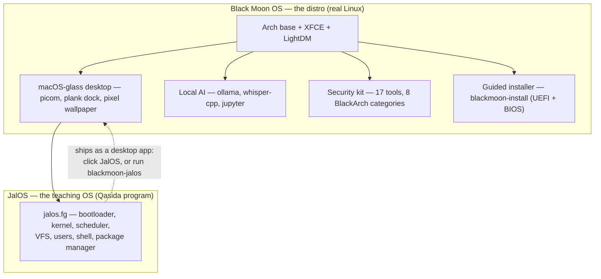
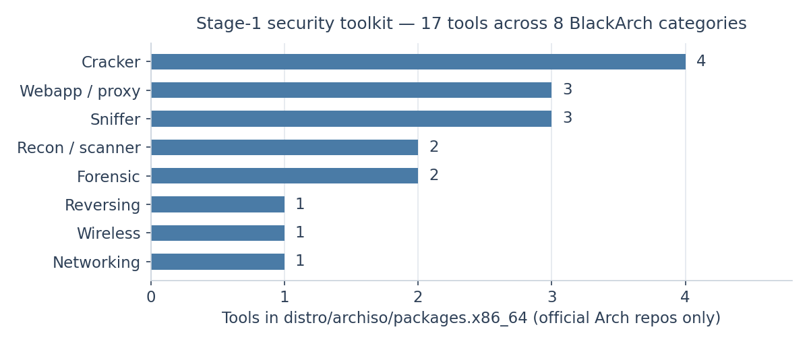

# Black Moon OS — JalOS and the distro

[](LICENSE)
[](https://pypi.org/project/qasida/)
[](https://github.com/themythofsisyphusjayant/BLACK-MOON-OS-/actions)

Two layers, one repo: **JalOS**, a complete teaching operating system written in Qasida, and **Black Moon OS**, a bootable Arch-based Linux distribution that ships JalOS as an app.


*The desktop wallpaper: a pixel-art night scene (blocky moon, stars, mountains, checkerboard ground), generated in pure Python by `distro/tools/make_wallpaper.py` — no Pillow. It doubles as the boot splash (`distro/archiso/syslinux/splash.png`).*

## Status

| Item | State |
|---|---|
| JalOS (`jalos.fg`) | Complete teaching OS, 1,408 lines — October 2026 version |
| Kernel track | Moved to [MOON-OS](https://github.com/themythofsisyphusjayant/MOON-OS) (Phases A–F done, unified kernel, idle task) |
| Distro profile (`distro/`) | Complete on paper — Arch + XFCE, macOS-style glass desktop, local AI, 17-tool security kit |
| ISO build | Built 27 Oct 2026 via GitHub Actions (run 40498188879, `success`) — artifact `blackmoon-iso` |
| Live boot | Untested — no first boot yet, in a VM or on hardware |
| Last code change | 29 Oct 2026 (this README rewritten 20 Nov 2026) |

This repo was last updated 29 Oct 2026. The JalOS copy here is the October 2026 version; the current copy, and the from-scratch kernel track it feeds, live in [MOON-OS](https://github.com/themythofsisyphusjayant/MOON-OS).

## The two layers



The distinction matters and is documented in the distro README: the distro is a real Linux system; JalOS itself runs *on top of* an OS and is not a kernel.

## JalOS — a complete teaching OS in Qasida

JalOS is every subsystem a modern OS has — bootloader, kernel, priority scheduler, virtual memory allocator, hierarchical filesystem with permissions, users, devices, networking, a package manager, system services, logging, and a ~30-command shell — implemented in [Qasida](https://pypi.org/project/qasida/) (formerly the Jal Pari Language; source in [RED-MOON-](https://github.com/themythofsisyphusjayant/RED-MOON-)) and running as a single program (`jalos.fg`).

| Subsystem | What JalOS does |
|---|---|
| Bootloader + kernel + init | Banner, RAM test, rootfs mount, daemon startup, login |
| Process management | Fixed process table, spawn, kill, ps/top |
| Scheduler | Priority scheduling in one-step quanta, tick log |
| Memory management | First-fit free-list allocator over 1024 simulated words, split + coalesce, `malloc`/`free`/`mem` |
| Filesystem | Hierarchical VFS (inodes by index), mkdir/write/cat/cp/mv/rm/ls, `/proc` pseudo-filesystem |
| Permissions + users | root/guest, file owners, owner-or-root checks, `su`, `useradd`, `/etc/passwd` |
| Devices | Console, loopback network device, disk (the VFS) |
| Networking | `ping` (loopback, simulated), `ifconfig`, `httpget` (real HTTP through the host stack) |
| Package manager | `pkg list/search/info/install/remove` — install really fetches the package source over HTTPS from the Qasida registry |
| Services + logging | cron (heartbeat every 5 ticks), syslog (`/var/log/syslog`), `logger`, `services` |
| Shell | ~30 commands, script files, single-command mode, `history`, `env`, `uptime`, `df`, `shutdown`, `ai`, `audit` |

Two copies of `jalos.fg` are vendored here (repo root and `distro/archiso/airootfs/usr/share/blackmoon/jalos.fg`), byte-identical to RED-MOON-'s `examples/os/jalos.fg` — RED-MOON- owns JalOS; this repo vendors it. Do not edit these copies here; see `INTEGRATION.md` for the re-sync procedure.

## Run it

Install Qasida once (`pip install qasida`; current release 2.3.0). The scripts in this repo still default to the old `jalpari` command name — with the current release, set `FORGE` to `qasida`:

```sh
FORGE=qasida ./run.sh                       # the built-in demo tour
FORGE=qasida ./run.sh script.txt            # run a script file (see scripts/)
FORGE=qasida ./run.sh ps                    # a single command
```

`tests/check.sh` runs the demo tour and diffs it against `tests/expected_output.txt` — the tour is offline and deterministic, so it must match exactly.

```sh
FORGE=qasida ./tests/check.sh              # regression check: demo output must match exactly
```

## Black Moon OS — the distro

JalOS also ships inside a real, bootable Arch-based Linux distribution: XFCE desktop, Firefox/Chromium, GNOME Software, a guided installer, and Qasida. See [`distro/README.md`](distro/README.md) — build it with `./distro/build.sh` on Arch Linux, or via the GitHub Actions workflow (`.github/workflows/build-iso.yml`).

### What is inside the ISO

| Layer | Contents |
|---|---|
| Base + desktop | Arch base, XFCE + LightDM (live session autologs in as root), `pacman`, `systemd`, `bash` |
| Look | Retro pixel + macOS glass: pixel night-scene wallpaper and boot splash, `picom` blur/translucency/rounded corners, `plank` dock, `terminus-font`, top menu bar, window buttons on the left |
| Apps | Firefox + Chromium, GNOME Software + Flatpak, LibreOffice, VLC, mpv, GIMP, Inkscape, Evince, Mousepad — plus the Moon apps (Notes, Gallery, Browser, Code), all written in Qasida |
| Local AI | `ollama` (local LLMs; `blackmoon-ai`, small `qwen2:0.5b` suggested first), `whisper-cpp` (speech-to-text), `jupyter-notebook` — no cloud account; plus JalOS's own `ai` command, a tiny perceptron that learns the OR gate |
| Security | 17 tools from official Arch repos across 8 BlackArch categories (below); `blackmoon-sec` runs a localhost-only audit |
| Installer | `blackmoon-install` — guided, UEFI + BIOS, wipes the target disk, creates a real user with sudo |

### Security toolkit — stage 1 of the BlackArch roadmap

17 tools, all verified in Arch's official Extra repo before being added (one bad name breaks the whole mkarchiso build). This is a start, not parity: BlackArch itself is 2000+ tools in ~50 groups, and reaching it is staged in `distro/README.md` (stage 2 adds the real BlackArch repo post-install; stage 3 claims parity only after a booted, tested ISO).



| Category | Tools |
|---|---|
| Cracker (4) | hashcat, john, hydra, ncrack |
| Webapp / proxy (3) | mitmproxy, sqlmap, gobuster |
| Sniffer (3) | wireshark-qt, wireshark-cli, tcpdump |
| Recon / scanner (2) | nmap, hping |
| Forensic (2) | sleuthkit, binwalk |
| Reversing (1) | radare2 |
| Wireless (1) | aircrack-ng |
| Networking (1) | openbsd-netcat |

Deliberately **not** in the package list (checked 27 Oct 2026, no official-repo evidence found): metasploit, burpsuite, ffuf, bettercap, whatweb, medusa, foremost, nuclei, subfinder — these come via the BlackArch repo or an AUR helper after first boot, never baked into the ISO list. `blackmoon-sec` lists the toolkit by category on the live system; anything beyond localhost is deliberately not scripted — use the tools directly, only with written permission for that target.

### Build the ISO

On Arch Linux only (`mkarchiso` needs pacman and Arch's repos — it cannot be built on Debian/Ubuntu):

```sh
sudo pacman -S archiso
./distro/build.sh
# -> distro/out/blackmoon-*.iso
```

Or via GitHub Actions: Actions tab → Build Black Moon ISO → Run workflow (it also runs on any push touching `distro/**`). The ISO is uploaded as the `blackmoon-iso` artifact.

**Build history, verified via the Actions API:** the first two runs on 27 Oct 2026 failed; the build was fixed the same day (grub installed on the builder — `mkarchiso` needs `grub-install` for UEFI validation), and the final run that day (40498188879) concluded `success`. An ISO was therefore built — but it has never been booted. Note: `distro/README.md` still carries its pre-build "ISO NOT built or booted yet" status line; the successful Actions run supersedes the "not built" half of it.

### Test it, install it

```sh
qemu-system-x86_64 -cdrom distro/out/blackmoon-*.iso -m 4096 -enable-kvm -boot d
```

Or write it to a USB stick (destroys the stick's contents):

```sh
sudo dd if=distro/out/blackmoon-*.iso of=/dev/sdX bs=4M status=progress oflag=sync
```

Boot the ISO, open a terminal, run `blackmoon-install`, follow the prompts, reboot. After first boot: `sudo pacman -Syu`, and `blackmoon-jalos` for the teaching OS.

## Limits

- **Not bootable — yet.** JalOS itself still runs on top of a host OS: it is a simulation, not a kernel. The language underneath it has since gained the pieces a bootable kernel needs — freestanding mode (`--freestanding`: no libc, own `_start`), raw memory (`peek32`/`poke32`), bitwise operators, CSR builtins, an `ecall` builtin, and a `trap_handler` hook. That kernel track now lives in [MOON-OS](https://github.com/themythofsisyphusjayant/MOON-OS) (Phases A–F done, idle task integrated, unified kernel). JalOS's ideas feed that kernel, but JalOS the program does not become it. What Qasida still lacks for kernel work: pointers and inline assembly.
- **Live boot untested.** The ISO built, but no first boot has happened — the glass theme, AI/security launchers, installer, and macOS-look pieces are all untested until it does. The installer is BETA and wipes its target disk by design: test in a VM before any real disk.
- **No GUI.** No graphics builtins exist, so the desktop is the text shell.
- **No passwords worth trusting.** Passwords are compared as plain strings (no hashing builtin exists) — the user model demonstrates permissions, it does not secure anything real.
- **HTTPS works through proxies.** `pkg install` and `httpget` over HTTPS honour `https_proxy` / `HTTPS_PROXY` (plain HTTP proxy, `CONNECT` handshake before TLS; `no_proxy` bypasses it). Plain HTTP works everywhere regardless.
- **No persistence.** The VFS lives in memory; shutdown loses it.
- **Live session runs as root** (standard for live images; the installed system does not). If the graphical login ever fails to appear, the console is still root-autologin: run `startxfce4`.

## Layout

```text
jalos.fg            the teaching OS (single Qasida program, 1,408 lines)
run.sh              demo tour / script / single-command runner (FORGE=qasida)
scripts/            example script files
tests/              check.sh + expected_output.txt (exact-output regression check)
distro/             archiso profile, build.sh, distro README, package list
docs/               security-tools.png (figure for this README)
INTEGRATION.md      how the two layers fit together (incl. JalOS re-sync)
LICENSE             MIT
```

## Links

- The language: [RED-MOON- (Qasida source)](https://github.com/themythofsisyphusjayant/RED-MOON-) · [Qasida on PyPI](https://pypi.org/project/qasida/) (`pip install qasida`)
- The kernel track: [MOON-OS](https://github.com/themythofsisyphusjayant/MOON-OS)
- The CPU: [BIG-32](https://github.com/themythofsisyphusjayant/BIG-32)
- Distro details: [distro/README.md](distro/README.md) · ISO builds: [Actions](https://github.com/themythofsisyphusjayant/BLACK-MOON-OS-/actions)
